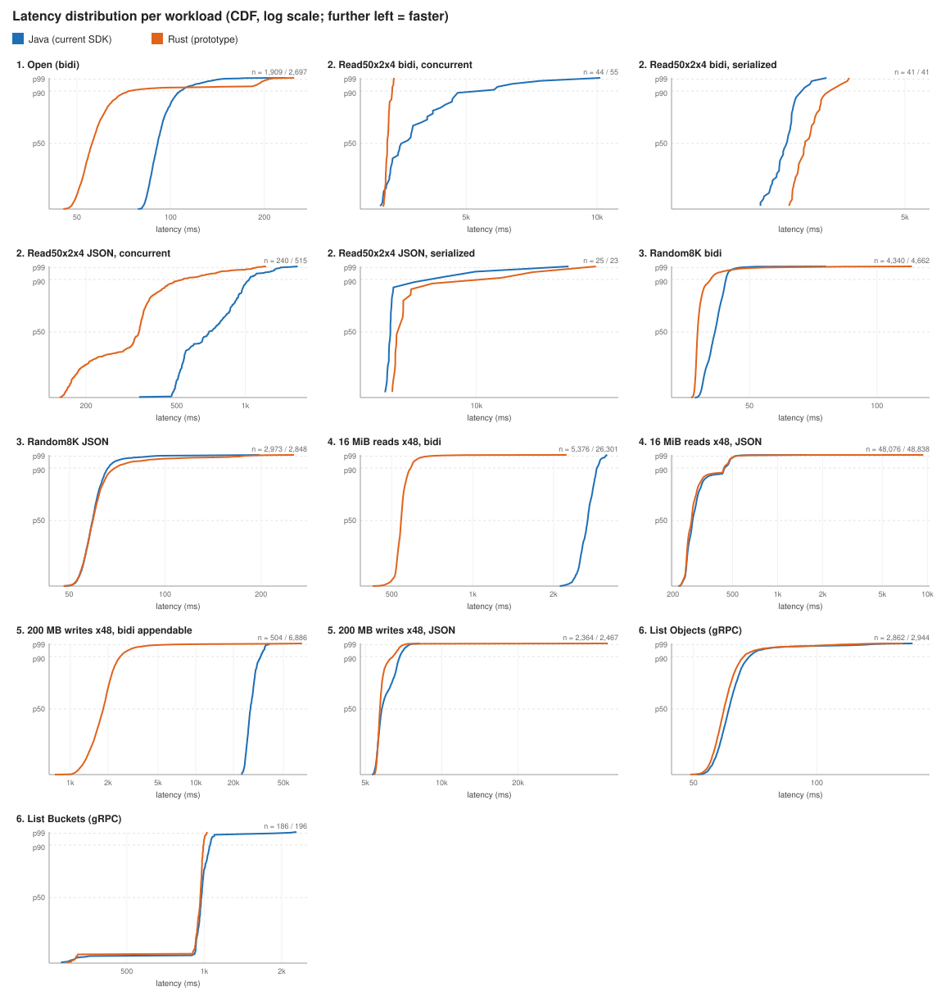
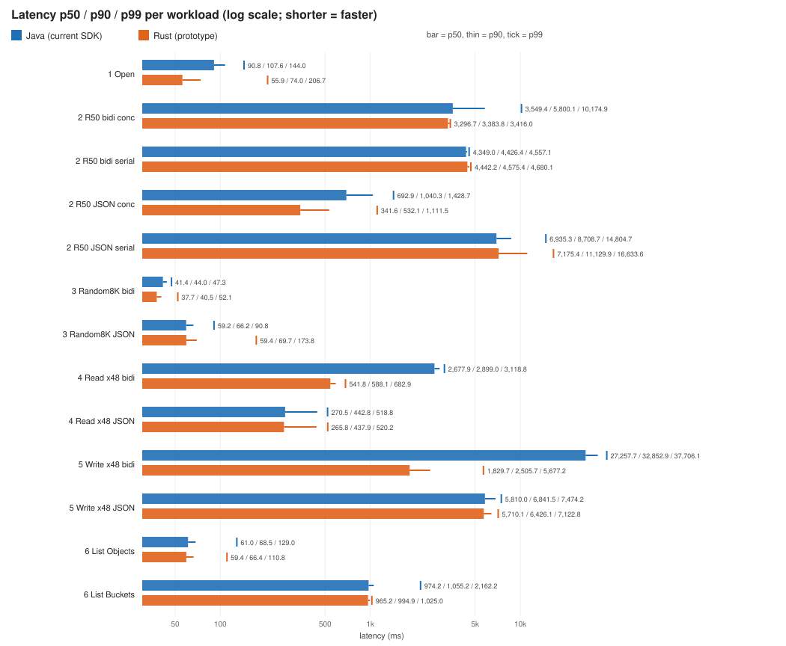
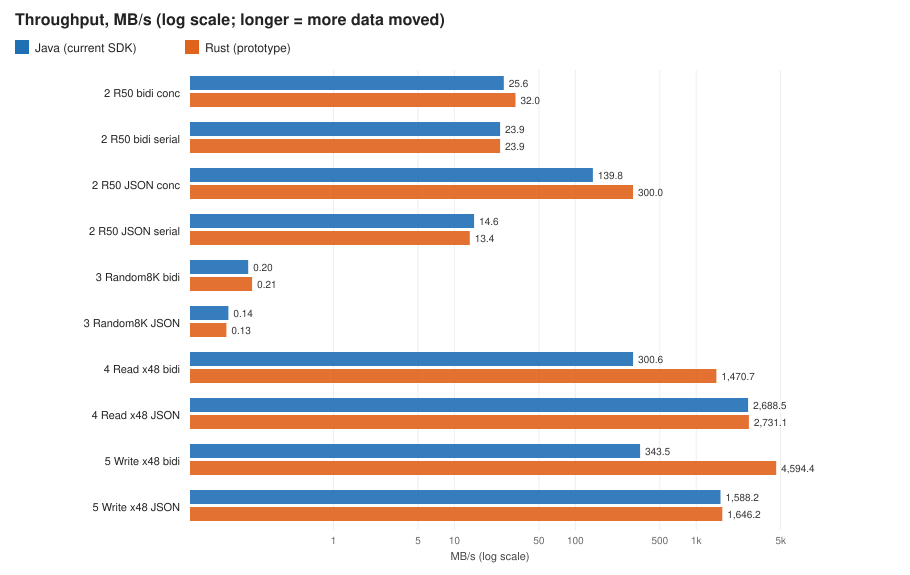
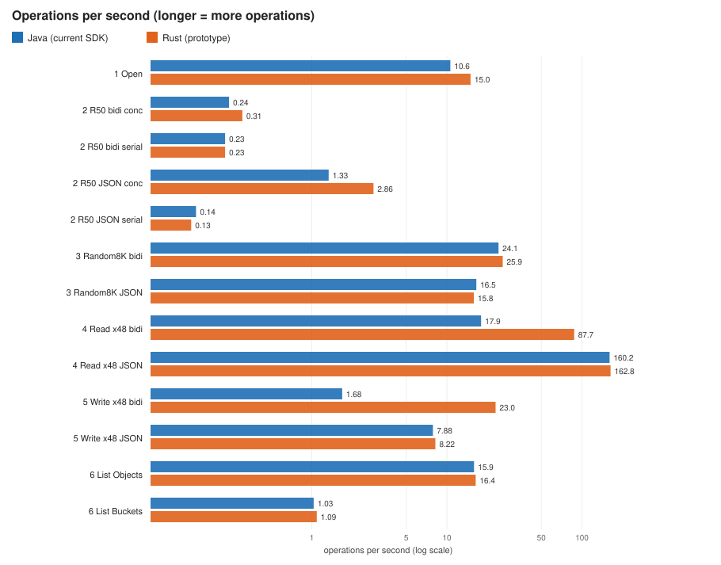
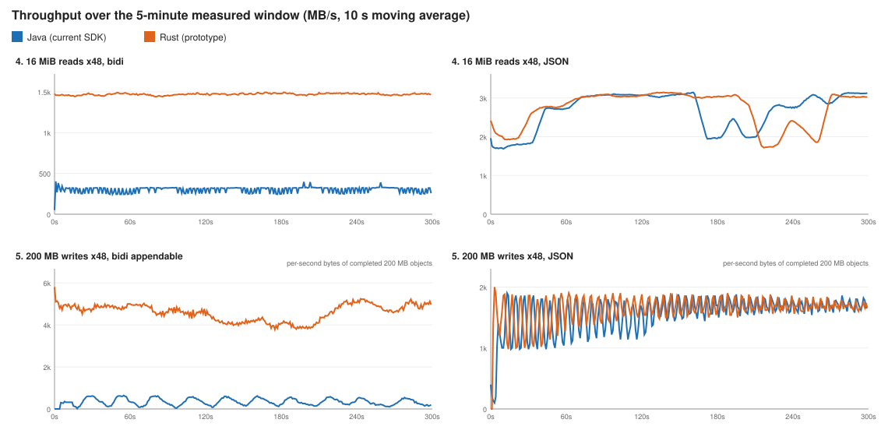
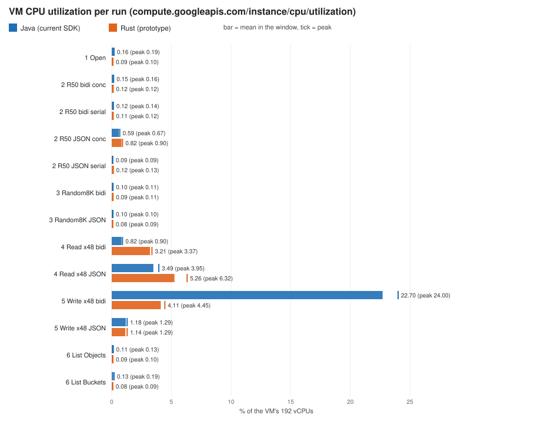
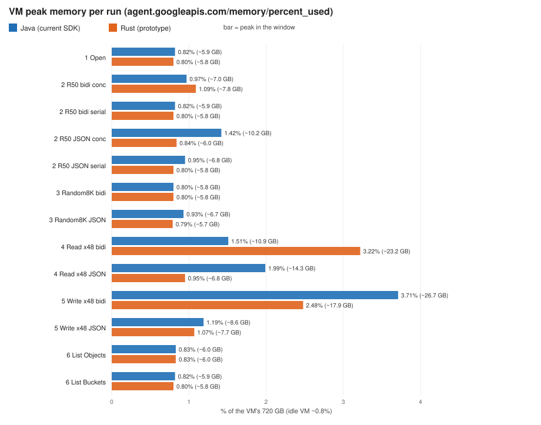
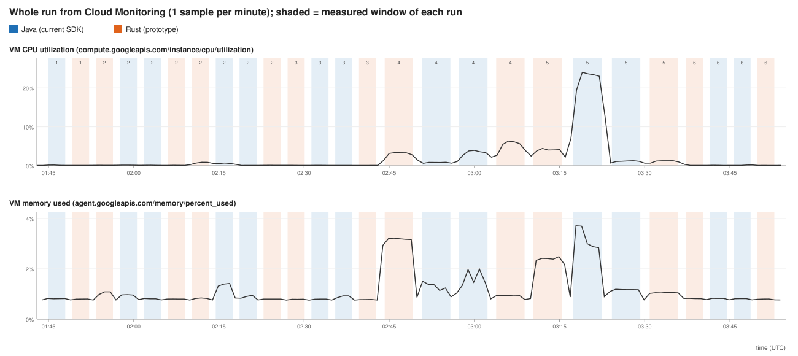
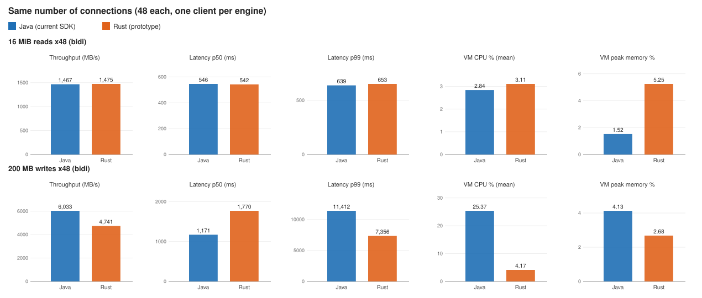

# Rust PoC benchmark results: java-storage on Java vs on the Rust SDK

Run on 2026-11-05, 01:44–04:08 UTC. One pass of 26 runs, **0 errors in every run**.

## What was compared

The same jar and the same public java-storage calls on both engines. The only difference is the
JVM flag `-Dgcs.rust.lib=<libgcs_rust_ffi.so>`. Without it the calls run on the Java path (current
SDK, the baseline). With it they run on the released Rust Storage SDK 1.20 through JNI (the
prototype).

| Operation | SDK method | Bucket |
|---|---|---|
| BidiReadObject (gRPC) | `blobReadSession(BlobId, ...)` | regional |
| BidiWriteObject (gRPC) | `blobAppendableUpload(BlobInfo, BlobAppendableUploadConfig, ...)` | zonal (Rapid) |
| ReadObject (JSON) | `reader(String bucket, String blob, ...)` | regional |
| WriteObject (JSON) | `writer(BlobInfo, ...)` | regional |
| ListObjects (gRPC) | `list(String bucket, BlobListOption...)` | regional |
| ListBuckets (gRPC) | `list(BucketListOption...)` | project |

Both engines use their **default settings**, which is what a user gets out of the box. Both use
CloudPath.

## Environment

| | |
|---|---|
| VM | `c4-standard-192` (192 vCPU, 720 GB), Ubuntu 24.04 LTS, `us-central1-f`, gVNIC, Tier_1 networking, Ops Agent |
| Buckets | `dhriti-read-west1` (regional, `us-west1`), `dhriti-zonal-read-west1` (Rapid, `us-west1-a`). The VM and the buckets are in different regions on purpose. |
| Project | `gcs-hyd-connector-benchmarks` |
| Code | branch `ffi-java` at `985016a` on github.com/Dhriti07/google-cloud-java; java-storage 2.77.0 (branch build); Rust `google-cloud-storage` 1.20.0 |
| Jar | `rust-poc-benchmark-985016a.jar`, sha256 `4d60f04bbfaca6a1254d65c6c29e29c0626ab91ce5465a599bc8dd75384a50da` |
| JVM | OpenJDK 21.0.12, no heap flags (the JVM sizes the heap itself), identical flags for both engines |
| Command | `bash java-storage/rust-poc-benchmark/scripts/run_all.sh` (after a 45 s smoke test of all 26 runs) |

## How each metric is measured

| Metric | How |
|---|---|
| Latency p50 / p90 / p99 | High-resolution timer around the outermost Java API call(s) of each operation. Only operations that end inside the measured window count. |
| Throughput | Data transferred ÷ measured time, in MB/s (1 MB = 10^6 bytes), plus operations per second. Writes count the bytes written inside the window. |
| CPU utilization | `compute.googleapis.com/instance/cpu/utilization`, mean (and peak) of the samples in the measured window. The metric covers the whole VM, sampled once a minute. |
| Peak memory | Highest `agent.googleapis.com/memory/percent_used` (state `used`) in the measured window. It covers the whole VM: 1% ≈ 7.2 GB, and the idle VM sits at about 0.8%. |

Measured window per run:
- Workloads 1, 2, 3, 6: 3 min, 1 thread, one operation at a time, after a 10 s warm-up.
- Workloads 4, 5: 5 min, 48 threads, after a 30 s warm-up.
- 60 s cooldown between runs. The engine that goes first alternates by workload.

## Results

### Overview charts

All charts compare Java (blue, current SDK) with Rust (orange, prototype). The data behind them
is in [`results/2026-11-05/`](results/2026-11-05/).

#### Latency

Definition: the total time to complete the workload from the client application's point of view.
Measured with a high-resolution timer around the outermost Java API call(s), reported as p50, p90
and p99.

Distribution of every measured operation (CDF; further left means faster):

p50 / p90 / p99 per workload:

#### Throughput

Definition: the rate at which data is successfully transferred. Measured as total data
transferred ÷ measured time, in MB/s and in operations per second. Rust (prototype) is run against
Java (current SDK) on the same workload.

Over time, for the 48-thread workloads. The write panels count completed 200 MB objects per
second, so they look spikier than the window throughput in the tables.

#### CPU utilization

Definition: the percentage of processing power consumed during the operations. Measured with
`compute.googleapis.com/instance/cpu/utilization`.

#### Peak memory

Definition: the peak memory during the run. Only the peak is measured, because Java and Rust
allocate and reuse memory differently. Rust typically creates a new buffer every time, where
other languages such as C++ reuse buffers, and the Rust implementation needs optimizing to reuse
buffers. Measured with `agent.googleapis.com/memory/percent_used`.

#### CPU and memory across the whole run

Each shaded band is the measured window of one run: blue for Java, orange for Rust, and the
number on top is the workload.

### Detailed tables

"Rust vs Java" compares Rust with Java: lower is better for latency, CPU and memory; higher is
better for throughput.

#### 1. Open: start a Bidi Read and wait for the first response (metadata), then close

| | p50 ms | p90 ms | p99 ms | ops/s | CPU % mean (peak) | Peak mem % | TCP conns |
|---|--:|--:|--:|--:|--:|--:|--:|
| Java | 90.8 | 107.6 | 144.0 | 10.6 | 0.16 (0.19) | 0.82 | 1 |
| Rust | 55.9 | 74.0 | 206.7 | 15.0 | 0.09 (0.10) | 0.80 | 193 |
| Rust vs Java | −38% | −31% | +44% | +41% | | | |

JSON: not applicable (JSON has no stream to open).

#### 2. Read50x2x4: 50 reads of 2 MiB at a 4 MiB stride from a 200 MiB object

Latency is the time to complete all 50 reads.

| Transport, mode | Engine | p50 ms | p90 ms | p99 ms | MB/s | CPU % mean (peak) | Peak mem % | TCP |
|---|---|--:|--:|--:|--:|--:|--:|--:|
| Bidi, concurrent | Java | 3,549 | 5,800 | 10,175 | 25.6 | 0.15 (0.16) | 0.97 | 1 |
| Bidi, concurrent | Rust | 3,297 | 3,384 | 3,416 | 32.0 | 0.12 (0.12) | 1.09 | 51 |
| Bidi, serialized | Java | 4,349 | 4,426 | 4,557 | 23.9 | 0.12 (0.14) | 0.82 | 1 |
| Bidi, serialized | Rust | 4,442 | 4,575 | 4,680 | 23.9 | 0.11 (0.12) | 0.80 | 60 |
| JSON, concurrent | Java | 693 | 1,040 | 1,429 | 139.8 | 0.59 (0.67) | 1.42 | 6 |
| JSON, concurrent | Rust | 342 | 532 | 1,112 | 300.0 | 0.82 (0.90) | 0.84 | 50 |
| JSON, serialized | Java | 6,935 | 8,709 | 14,805 | 14.6 | 0.09 (0.09) | 0.95 | 1 |
| JSON, serialized | Rust | 7,175 | 11,130 | 16,634 | 13.4 | 0.12 (0.13) | 0.80 | 1 |

#### 3. Random8K: random 8 KiB reads from a 100 MiB object, one at a time

| Transport | Engine | p50 ms | p90 ms | p99 ms | reads/s | CPU % mean (peak) | Peak mem % | TCP |
|---|---|--:|--:|--:|--:|--:|--:|--:|
| Bidi (open session) | Java | 41.4 | 44.0 | 47.3 | 24.1 | 0.10 (0.11) | 0.80 | 1 |
| Bidi (open session) | Rust | 37.7 | 40.5 | 52.1 | 25.9 | 0.09 (0.11) | 0.80 | 34 |
| JSON (one request per read) | Java | 59.2 | 66.2 | 90.8 | 16.5 | 0.10 (0.10) | 0.93 | 1 |
| JSON (one request per read) | Rust | 59.4 | 69.7 | 173.8 | 15.8 | 0.08 (0.09) | 0.79 | 1 |

#### 4. 16 MiB reads of a 200 MB object, 48 threads, 5 min

| Transport | Engine | p50 ms | p90 ms | p99 ms | MB/s (Gbps) | CPU % mean (peak) | Peak mem % | TCP | NIC rx Gbps |
|---|---|--:|--:|--:|--:|--:|--:|--:|--:|
| Bidi | Java | 2,678 | 2,899 | 3,119 | 300.6 (2.40) | 0.82 (0.90) | 1.51 | 1 | 2.55 |
| Bidi | Rust | 542 | 588 | 683 | 1,470.7 (11.77) | 3.21 (3.37) | 3.22 | 64 | 12.47 |
| JSON | Java | 271 | 443 | 519 | 2,688.5 (21.51) | 3.49 (3.95) | 1.99 | 48 | 22.78 |
| JSON | Rust | 266 | 438 | 520 | 2,731.1 (21.85) | 5.26 (6.32) | 0.95 | 49 | 23.14 |

#### 5. 200 MB writes, 48 threads, 5 min

| Transport | Engine | p50 ms | p90 ms | p99 ms | MB/s (Gbps) | objects/s | CPU % mean (peak) | Peak mem % | TCP | NIC tx Gbps |
|---|---|--:|--:|--:|--:|--:|--:|--:|--:|--:|
| Bidi appendable (zonal) | Java | 27,258 | 32,853 | 37,706 | 343.5 (2.75) | 1.68 | 22.70 (24.00) | 3.71 | 1 | 2.80 |
| Bidi appendable (zonal) | Rust | 1,830 | 2,506 | 5,677 | 4,594.4 (36.76) | 22.95 | 4.11 (4.45) | 2.48 | 192 | 36.94 |
| JSON (regional) | Java | 5,810 | 6,842 | 7,474 | 1,588.2 (12.71) | 7.88 | 1.18 (1.29) | 1.19 | 48 | 12.77 |
| JSON (regional) | Rust | 5,710 | 6,426 | 7,123 | 1,646.2 (13.17) | 8.22 | 1.14 (1.29) | 1.07 | 48 | 13.21 |

#### 6. List Objects and List Buckets, 100 items per page

| Operation | Engine | p50 ms | p90 ms | p99 ms | items/s | CPU % mean (peak) | Peak mem % | TCP |
|---|---|--:|--:|--:|--:|--:|--:|--:|
| List Objects (gRPC) | Java | 61.0 | 68.5 | 129.0 | 1,590 | 0.11 (0.13) | 0.83 | 1 |
| List Objects (gRPC) | Rust | 59.4 | 66.4 | 110.8 | 1,635 | 0.09 (0.10) | 0.83 | 1 |
| List Buckets (gRPC) | Java | 974 | 1,055 | 2,162 | 103 | 0.13 (0.19) | 0.82 | 1 |
| List Buckets (gRPC) | Rust | 965 | 995 | 1,025 | 109 | 0.08 (0.09) | 0.80 | 1 |

List over JSON is not part of the PoC.

## Additional run: same number of connections (48 each)

The tables above use each engine's default connections (Java 1, Rust up to one per CPU). This
additional run gives **both engines 48 gRPC connections from a single client**, for the two
48-thread Bidi workloads, so the engines can be compared without the connection difference.

| | How it gets 48 connections |
|---|---|
| Java | One `Storage` client with `-Dgcs.java.grpc.channels=48`. This is a PoC-only, off-by-default setting that passes `ChannelPoolSettings.staticallySized(48)` to gax; java-storage doesn't expose a pool size. gax hands each new call to the next connection in turn. |
| Rust | One client with `-Dgcs.rust.grpc.subchannels=48` |

Run on 2026-11-05, 08:15–08:54 UTC, on the same VM, buckets, jar build and JVM flags as above.
Java and Rust ran back to back for each workload, with a 60 s cooldown. Measured windows were
5 min after a 30 s warm-up. A 45 s smoke test of both setups passed first. **0 errors in every
run.** The TCP column confirms both engines used about 48 connections. Raw data:
[`results/2026-11-05-matched-48conn/`](results/2026-11-05-matched-48conn/).

#### 16 MiB reads of a 200 MB object, 48 threads, Bidi, 48 connections each

| Engine | p50 ms | p90 ms | p99 ms | MB/s (Gbps) | CPU % mean (peak) | Peak mem % | TCP | NIC rx Gbps |
|---|--:|--:|--:|--:|--:|--:|--:|--:|
| Java | 546 | 581 | 639 | 1,467.2 (11.74) | 2.84 (3.34) | 1.52 | 48 | 12.44 |
| Rust | 542 | 584 | 653 | 1,475.1 (11.80) | 3.11 (3.34) | 5.25 | 49 | 12.51 |

#### 200 MB writes, 48 threads, Bidi appendable, 48 connections each

| Engine | p50 ms | p90 ms | p99 ms | MB/s (Gbps) | objects/s | CPU % mean (peak) | Peak mem % | TCP | NIC tx Gbps |
|---|--:|--:|--:|--:|--:|--:|--:|--:|--:|
| Java | 1,171 | 1,906 | 11,413 | 6,033.0 (48.26) | 30.13 | 25.37 (27.95) | 4.13 | 48 | 50.61 |
| Rust | 1,770 | 2,968 | 7,356 | 4,741.0 (37.93) | 23.73 | 4.17 (4.69) | 2.68 | 48 | 38.16 |

**What this shows**

- **Reads:** with the same connections, **throughput and latency are even** (11.74 vs
  11.80 Gbps, p50 546 vs 542 ms). CPU is about the same. Rust's **peak memory is about 3.5×**
  Java's (5.25% vs 1.52% of the VM, about 38 vs 11 GB).
- **Writes:** with the same connections, **Java moves about 27% more data** (48.3 vs
  37.9 Gbps) and has a lower median latency. But Java uses **about 6× the CPU** (25.4% vs 4.2%
  of the VM, about 49 vs 8 vCPUs), which is about 5× more CPU per Gbps. Java also has a longer
  p99 tail (11.4 vs 7.4 s) and higher peak memory (4.13% vs 2.68%).
- So the large Rust lead in the default-settings tables comes from the connection count. With
  connections matched, Rust's clear advantage is **CPU on writes**, and its clear disadvantage is
  **memory on reads**.

## How data moves between Java and Rust

Protobuf is used only for metadata (object info and list results). Object bytes are copied
directly, once in each direction, through JNI:

| Path | Copy | Who allocates |
|---|---|---|
| Bidi Read (`readAs(asFutureBytes())`) | Rust copies each received chunk into the Java `byte[]` (`SetByteArrayRegion`) | Java: the result array. The Rust SDK: a new buffer for each received chunk. |
| Read (JSON) (`reader().read(dst)`) | Rust copies the next response bytes into the caller's buffer (`memcpy` for a direct `ByteBuffer`) | The caller; the Rust SDK for each HTTP chunk |
| Bidi Appendable Write (`write(src)`) | Rust copies the caller's bytes into a Rust buffer (`GetDirectBufferAddress` + copy), then the SDK sends it | Rust, for each write call |
| Write (JSON) (`write(src)`) | Same as Bidi Appendable Write; the buffer then goes to the upload task | Rust, for each write call |

The Java path makes the same single copy for these APIs. The higher Rust peak memory on Bidi
reads comes from the Rust SDK allocating a fresh buffer per received chunk, not from the JNI copy.

## FYI: TCP connections and threads

The two engines use a different number of gRPC connections by default, but that difference only
matters in the 48-thread tests:

- A gRPC **stream** (one read session or one upload) always runs on a **single connection**. Many
  streams can share one connection, but they then share its capacity.
- **Java** uses **1 connection** by default. **Rust** opens **many** (up to one per CPU).

**Tests 1, 2 and 3** (Open, Read50x2x4, Random8K):

- These use **one thread with one stream** at a time.
- So only **one connection carries data**, on both Java and Rust. Rust's extra connections stay
  idle.
- The results were close (e.g. Random8K 41 vs 38 ms), so the differences here come from the
  engines, not connections.

**Tests 4 and 5** (48 parallel reads / writes):

- These run **48 streams at the same time**.
- **Java** puts all 48 on its **one connection**, so they share its limited capacity.
- **Rust** spreads them over **64–192 connections**, so they run in parallel.
- Result: Rust was much faster (reads 11.8 vs 2.4 Gbps, writes 36.8 vs 2.8 Gbps).
- In an earlier test where both used 48 connections, reads were about equal. So most of the gap
  comes from the number of connections, not the engine speed.

## What the numbers show

- **Bidi, 48 threads (4 and 5):** Rust moves far more data.
  - Reads: 11.8 vs 2.4 Gbps. Writes: 36.8 vs 2.8 Gbps.
  - The main reason is connections. By default the Rust SDK opens up to one gRPC connection per
    vCPU (64 used for reads, 192 for writes). A Java `Storage` uses one connection for all 48
    threads.
  - Rust also used far less CPU on writes: 4.1% vs 22.7% of the VM, about 8 vs 44 vCPUs.
- **Connections matched (previous run, for context only):** in the earlier VM run, Bidi reads at
  48 threads with 48 connections on both engines were about even: Java 11.5–11.7 Gbps, Rust
  11.7–11.8 Gbps. Most of the read gap above therefore comes from the default connection count,
  not from per-connection speed. That run used an earlier jar and a fixed 16 GB heap, so it is
  context, not part of this result.
- **JSON, 48 threads (4 and 5):** about even on throughput and latency (within 4%), with the same
  connection count (48).
  - JSON reads: Rust used more CPU (5.3% vs 3.5%) but less memory (0.95% vs 1.99%).
  - JSON writes: CPU and memory about the same.
- **Single operations (1, 2, 3, 6):**
  - Rust opens a Bidi Read faster at the median (56 vs 91 ms) but has a longer p99 (207 vs
    144 ms).
  - Bidi Random8K is close: p50 38 vs 41 ms.
  - Read50x2x4 concurrent over bidi has a much tighter tail on Rust: p99 3.4 vs 10.2 s.
  - Read50x2x4 concurrent over JSON is about 2× faster on Rust (342 vs 693 ms p50). Java's HTTP
    client used 6 connections there, Rust's 50.
  - Serialized reads and the lists are about even. List Buckets p99 is better on Rust (1.0 vs
    2.2 s).
- **Peak memory:** Rust is **higher for Bidi reads**: 3.22% vs 1.51% of the VM, about 23 vs 11 GB.
  This matches the expectation that the Rust path allocates a new buffer per read instead of
  reusing one. It is lower for Bidi writes (2.48% vs 3.71%) and for JSON reads (0.95% vs 1.99%).

## Caveats

1. **One pass.** Each number comes from a single run, with no spread across rounds. Comparing with
   the earlier runs and the 45 s smoke test:
   - The **Rust** Bidi numbers repeat closely: reads 11.77 vs 11.6–11.7 Gbps earlier; writes
     4,594 vs 4,770 MB/s in the smoke test.
   - The **Java single-connection** Bidi numbers vary a lot between runs: reads 2.40 Gbps here vs
     1.5–1.7 Gbps earlier and 1.6 Gbps in the smoke test; writes 2.75 Gbps here vs 1.2–1.25 Gbps
     earlier and in the smoke test.
   - So the Rust vs Java gap for Bidi at 48 threads is large in every run, but the exact Java
     figure is not stable. One connection carrying 48 streams is sensitive to network conditions.
2. **Defaults differ by design.** Connection counts are each engine's default (shown in the TCP
   column), so 4 and 5 compare what users get, not equal connection counts.
3. **The VM metrics are coarse for light workloads.** They sample the whole 192-vCPU, 720 GB VM
   once a minute. Single-thread workloads (1, 2, 3, 6) use about 0.1% CPU and stay near the idle
   memory level (about 0.8%), so small differences there are within noise.
4. **Cross-region.** The VM is in `us-central1` and the buckets are in `us-west1`. Absolute
   latency includes that distance. The comparison between engines holds, but absolute numbers
   would be lower in the same region.
5. **PoC limits on the Rust side.** It signs in with Application Default Credentials (the VM's
   service account here, the same as Java), and `FlushPolicy`, takeover and `capture()` are not
   implemented. None of these are used by the workloads.
6. **One status check overlapped a run.** A status check over SSH at 01:47:40 UTC fell inside the
   measured window of Open on Java (01:44:56–01:47:56). It lasted a few seconds.
7. **Fixes from the previous run that apply to both engines here:**
   - Writes overwrite each thread's own object. Keeping every object filled the project's Rapid
     storage quota.
   - Reads time out after 2 min and reopen the session.
   - Java's built-in gRPC client metrics are off, because only the Java path pays for them.
