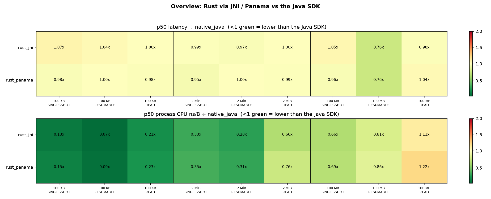
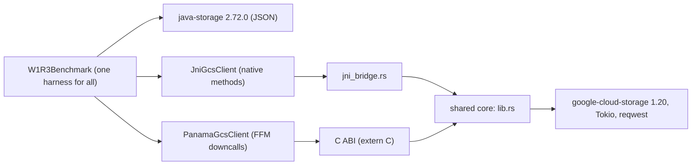

# Java on a Rust core: w1r3 (JSON) results, build cost, challenges

This PoC checks whether the Java Storage SDK (`com.google.cloud:google-cloud-storage`) could be a
thin Java layer over the shared Rust Storage SDK ([`google-cloud-storage` 1.20](https://crates.io/crates/google-cloud-storage)).
The same question was asked for the other languages:

| Language | Proof of concept |
|---|---|
| Python | [EVALUATION.md](https://github.com/raj-prince/google-cloud-python/blob/python-sdk-rust/packages/google-cloud-storage-rust/EVALUATION.md) |
| Go | [EVALUATION.md](https://github.com/cpriti-os/google-cloud-go/blob/go-sdk-rust-poc/storage/internal/rust-poc/EVALUATION.md) |
| C++ | [REPORT-w1r3.md](https://github.com/v-pratap/google-cloud-rust/blob/poc/cpp-rust-wrapper/examples/cpp-wrapper-poc/REPORT-w1r3.md) |
| **Java** | this document |

Scope: JSON transport, the `w1r3` workload from
[storage-shared-benchmarking](https://github.com/googleapis/storage-shared-benchmarking) (upload,
then read 3 times). Java has two ways to call native code, and both were built over the same Rust code:
**JNI** (works on Java 8+) and **Panama / FFM** (`java.lang.foreign`, Java 22+).

## 1. Summary

- **Latency:** the median (p50) is within ±7% of the Java SDK for every upload and read, except
  100 MB resumable uploads, where Rust is 0.76×. Almost all of that op's time is inside the Rust
  SDK (the bridge is 1.8–1.9%), so the difference comes from the Rust SDK's upload, not the
  wrapper. One round of `rust_jni` had three very slow operations (48–100 s; §2).
- **CPU:** whole-process CPU per byte is 0.07–0.35× the Java SDK for uploads and small reads,
  0.66–0.76× for 2 MiB reads, and **1.11× (JNI) / 1.22× (Panama) for 100 MB reads**.
- **Memory:** Rust allocates about 2 bytes per byte uploaded and 4.3–4.6 per byte read. A 100 MB
  upload grows process memory (RSS) by 95 MiB, because the `byte[]` is copied into Rust memory.
- **Bridge cost:** time spent outside the Rust SDK is 0.05–0.46 ms per operation (≤ 0.8%), except
  100 MB uploads (23–25 ms, 1.8–2.1%: the copy of the `byte[]` into Rust).
- **JNI vs Panama:** latency differences between them are inside the Rust SDK time (run-to-run
  variation). JNI uses less CPU than Panama in every case.
- **Build and size:** a one-file change rebuilds in 56 s for the Rust library vs 14 s for the Java
  Storage SDK. The Rust library adds 7–9 MB (compressed) per platform to the download.

## 2. Latency

Setup: GCE `c4-standard-2` (2 vCPU), Debian 12, `us-central1-a`, bucket in the same region.
Temurin 25 with `-Xms1g -Xmx1g -XX:+AlwaysPreTouch -XX:MaxDirectMemorySize=1g`. 200 iterations ×
4 rounds per implementation, one implementation at a time, order balanced (forward / reversed).
Retries off on both sides. HTTP/1.1 and CRC32C on both sides. 12,000 measured operations (incl. DELETE), 0
errors. All three run the same harness, the same object-size sequence and the same metrics.

| impl | what runs |
|---|---|
| `native_java` | java-storage 2.72.0 (`StorageOptions.http()`) |
| `rust_jni` / `rust_panama` | Rust Storage SDK 1.20 via JNI / Panama |

DELETE is left out: the Rust SDK deletes over gRPC (`StorageControl`), Java over JSON.

p50 in ms. In brackets: the p50 of each of the 4 rounds.

**100 KB**
| op | native_java | rust_jni | rust_panama |
|---|--:|--:|--:|
| SINGLE-SHOT | 87.5 (87.1–89.2) | 93.4 (85.4–95.9) | 85.4 (81.2–93.7) |
| RESUMABLE | 165.0 (157.2–174.5) | 170.8 (163.3–177.2) | 164.9 (158.2–167.6) |
| READ | 44.5 (42.7–47.4) | 44.4 (42.0–48.4) | 43.9 (41.9–46.8) |

**2 MiB**
| op | native_java | rust_jni | rust_panama |
|---|--:|--:|--:|
| SINGLE-SHOT | 113.4 (108.4–119.1) | 111.9 (106.4–120.7) | 107.8 (103.1–115.4) |
| RESUMABLE | 191.5 (182.6–201.9) | 186.7 (172.8–213.0) | 192.0 (168.1–203.8) |
| READ | 57.7 (55.2–63.7) | 57.6 (53.7–61.9) | 57.1 (55.3–60.2) |

**100 MB**
| op | native_java | rust_jni | rust_panama |
|---|--:|--:|--:|
| SINGLE-SHOT | 1240 (1192–1355) | 1304 (1214–1348) | 1197 (1103–1322) |
| RESUMABLE | 1712 (1381–2132) | 1295 (1132–1344) | 1301 (1127–1446) |
| READ | 525 (498–556) | 514 (438–595) | 544 (520–589) |

- The round ranges overlap for everything except 100 MB resumable.
- **Slow operations:** in round 2, `rust_jni` had three: a 100 KB single-shot (66.3 s), a 2 MiB
  single-shot (48.6 s) and a 100 MB read (100.4 s). All three succeeded, and almost all of the time
  was inside the Rust SDK (bridge < 0.03 s). They make `rust_jni`'s 100 KB single-shot mean 582 ms
  (p50 93 ms). The slowest `native_java` op was 17.2 s and the slowest `rust_panama` op 12.0 s. The
  cause was not investigated.



More graphs per size (percentiles, CDF, p50 per round, every op over time) are in
[results/w1r3-20261013-160441/graphs](results/w1r3-20261013-160441/graphs).

## 3. CPU

Whole-process CPU (all threads, `clock_gettime(CLOCK_PROCESS_CPUTIME_ID)`) per byte, p50, as a ratio
to `native_java`. Measured the same way for all three.

| size | op | rust_jni | rust_panama |
|---|---|--:|--:|
| 100 KB | SINGLE-SHOT | 0.13× | 0.15× |
| 100 KB | RESUMABLE | 0.07× | 0.09× |
| 100 KB | READ | 0.21× | 0.23× |
| 2 MiB | SINGLE-SHOT | 0.33× | 0.35× |
| 2 MiB | RESUMABLE | 0.28× | 0.31× |
| 2 MiB | READ | 0.66× | 0.76× |
| 100 MB | SINGLE-SHOT | 0.66× | 0.69× |
| 100 MB | RESUMABLE | 0.81× | 0.86× |
| 100 MB | READ | **1.11×** | **1.22×** |

Whole run (`timed_run.py`, user + sys over all 4 rounds): `native_java` 270 s, `rust_jni` 162 s,
`rust_panama` 180 s.

## 4. Memory: allocated vs held

Allocated bytes per byte moved, p50: exact Java heap allocations (`ThreadMXBean`) plus exact Rust
allocations (a counting global allocator in the Rust library).

| size | op | native_java | rust_jni | rust_panama |
|---|---|--:|--:|--:|
| 100 KB | SINGLE-SHOT | 1.55 | 2.67 | 2.68 |
| 100 KB | RESUMABLE | 169.83 | 2.83 | 2.84 |
| 100 KB | READ | 21.84 | 4.43 | 4.65 |
| 2 MiB | SINGLE-SHOT | 0.13 | 2.03 | 2.03 |
| 2 MiB | RESUMABLE | 8.11 | 2.04 | 2.04 |
| 2 MiB | READ | 1.06 | 4.34 | 4.62 |
| 100 MB | SINGLE-SHOT | 0.06 | 2.00 | 2.00 |
| 100 MB | RESUMABLE | 0.18 | 2.00 | 2.00 |
| 100 MB | READ | 0.04 | 4.35 | 4.62 |

- Java's resumable upload allocates a 16 MiB buffer per upload, hence 170 B/B at 100 KB.
- Rust's ~2 B/B on uploads: one copy of the `byte[]` into Rust memory, plus the SDK's own buffering.
- Held memory (peak RSS growth during the op): 0 MiB for all three, except 100 MB uploads, where Rust
  grows by **95 MiB** (Java: 0). Peak RSS is 1142–1247 MiB for all three, dominated by the 1 GiB
  pre-touched Java heap.

**Bridge overhead** = op time minus time inside the Rust SDK, measured in the same op, so network
time cancels out. p50:

| size | op | rust_jni | rust_panama |
|---|---|--:|--:|
| 100 KB | uploads / READ | 0.05 ms | 0.10–0.14 ms |
| 2 MiB | uploads / READ | 0.25–0.38 ms | 0.42–0.46 ms |
| 100 MB | uploads | 22.8 ms (1.8%) | 24.5 ms (2.1%) |
| 100 MB | READ | 4.3 ms (0.8%) | 8.6 ms (1.6%) |

## 5. Build time, repo and package size

Measured on the same 8-core workstation:

| | Java Storage SDK | Rust library |
|---|--:|--:|
| One-file change, rebuild | 14 s | 56 s |
| From scratch | 21 s (module only, deps pre-built) | 179 s |
| Build folder | | 1.1 GB |
| Third-party crates compiled | | 199 |

Package size (Rust library stripped, release):

| Platform | `.so` / `.dll` | In a jar (compressed) |
|---|--:|--:|
| Linux x86-64 (glibc ≥ 2.17) | 19.6 MB | 7.1 MB |
| Linux aarch64 | 17.8 MB | 6.9 MB |
| Linux x86-64 musl (Alpine) | 19.6 MB | 7.1 MB |
| Linux aarch64 musl | 17.8 MB | 6.9 MB |
| Windows x86-64 | 23.3 MB | 8.9 MB |
| All five in one jar | | 36.9 MB |

macOS can't be built from Linux (it needs Apple's SDK). Today `google-cloud-storage-2.72.0.jar` is
1.5 MB, and with all runtime dependencies a developer downloads 87 jars, 56.5 MB.

## 6. Key challenges: Java column

| Challenge | Java |
|---|---|
| **Mono Repo** | Users get pre-built jars, and jars already carry native code (e.g. `grpc-netty-shaded`, used by java-storage), so unlike Go nobody compiles Rust. The cost is ours: a new per-OS/CPU build, either in google-cloud-java or as a separate jar from the Rust side, pinned to one Rust version and coordinated with google-cloud-java's single repo-wide release. |
| **Platform-specific issues** | **Medium risk:** Java SDK uses native code today but it's optional: if it can't load, the SDK falls back to pure Java and still works. A Rust core would be required, so the SDK only works on platforms we build it for. Each OS, CPU and Linux variant needs its own build. In the PoC, a build made on a newer Linux didn't run on older Linux (Debian 12); building against an older Linux library fixed it. Linux ARM, Alpine and Windows builds compile but haven't been run; macOS hasn't been built. The Rust part also has its own networking, so TLS and proxy settings made in Java don't reach it. |
| **Platform reach** | **Needs alignment; Panama-only is a blocker, JNI is feasible.** java-storage supports Java 8+, and Panama needs [Java 22](https://openjdk.org/jeps/454). Since JDK 24, [JEP 472](https://openjdk.org/jeps/472) warns on JNI and Panama use, and a future release will require `--enable-native-access`. GraalVM native-image is supported today; JNI classes must be [listed in its config](https://www.graalvm.org/latest/reference-manual/native-image/dynamic-features/JNI/). Customers on platforms we don't build (e.g. IBM mainframe / Power) or on systems that block native code lose the SDK. |
| **Package Size** | **Manageable risk:** The Rust library is 18–23 MB per platform, or 7–9 MB compressed in a jar, similar to what the Python and C++ PoCs measured. Today the Storage jar is 1.5 MB, and a developer downloads 56.5 MB in total with its dependencies. With one platform's library (Linux x86-64), the Storage jar grows to about 8.6 MB and the total download to 63.6 MB (+13%). With all five platforms, the Storage jar grows to 38.5 MB and the total download to 93.5 MB (+65%). |
| **Tool chain, coordination and maintenance costs** | **High effort:** The SDK build needs Java (Maven), Rust (Cargo) and a C compiler. Measured on the same 8-core machine: changing one file and rebuilding takes 56 s for the Rust library vs 14 s for the Java Storage SDK; a from-scratch Rust build takes about 3 minutes, and its build folder is 1.1 GB. The Java–Rust glue is mostly hand-written: [UniFFI](https://github.com/mozilla/uniffi-rs), the usual generator, [officially supports Kotlin, Swift, Python and Ruby](https://github.com/mozilla/uniffi-rs/blob/main/uniffi_bindgen/src/bindings/mod.rs), not Java. Its Kotlin output runs on the JVM but [needs JNA](https://mozilla.github.io/uniffi-rs/latest/kotlin/gradle.html) and Kotlin in a Java SDK. The third-party [uniffi-bindgen-java](https://github.com/IronCoreLabs/uniffi-bindgen-java) (still unstable) and OpenJDK's [jextract](https://github.com/openjdk/jextract) only target [Panama, which needs Java 22+](https://openjdk.org/jeps/454). For JNI, which Java 8–21 needs, the glue stays hand-written. That glue is low-level, memory-unsafe code where mistakes crash the JVM, so the Java team needs Rust and JNI skills. |
| **Impedance mismatches** | **Manageable:** Solved in PoC → blocking Java calls (the Rust SDK runs on the calling Java thread), streaming reads into Java heap `ByteBuffer`s, and uploads from `byte[]`, over both JNI and Panama. Not yet built: mapping Rust errors to `StorageException` and streaming `WriteChannel` uploads. **Open concerns:** options that take Java objects need a bridge or can't run on a Rust transport. Custom [`Credentials`](https://cloud.google.com/java/docs/reference/google-auth-library/latest/com.google.auth.Credentials) and [`StorageRetryStrategy`](https://cloud.google.com/java/docs/reference/google-cloud-storage/latest/com.google.cloud.storage.StorageRetryStrategy) need callbacks from Rust into Java. [`OpenTelemetry`](https://javadoc.io/doc/io.opentelemetry/opentelemetry-api/latest/io/opentelemetry/api/OpenTelemetry.html) spans from the Java API keep working, but spans for work inside Rust need a bridge. A custom HTTP transport ([`setHttpTransportFactory`](https://cloud.google.com/java/docs/reference/google-cloud-core/latest/com.google.cloud.http.HttpTransportOptions.Builder#com_google_cloud_http_HttpTransportOptions_Builder_setHttpTransportFactory_com_google_auth_http_HttpTransportFactory_)) and JVM proxy/trust-store settings don't reach Rust's networking unless the glue passes them across. |
| **Harder debugging experience** | **High effort, not a blocker:** see §7. |

## 7. Harder debugging experience

**High effort, not a blocker:** The SDK's own code is Java today, so users debug it with the IDE
debugger, `jstack`, JFR and heap dumps. With a Rust core, Java error traces stop where Java calls
into Rust. To see the Rust side, you need native tools like gdb/lldb or
[async-profiler](https://github.com/async-profiler/async-profiler). A bug in the Java–Rust glue can
crash the whole JVM, leaving only a
[crash log](https://docs.oracle.com/en/java/javase/21/troubleshoot/fatal-error-log.html) instead of
a Java exception. Rust function names in that log add about 6 MB to the library (20 → 26 MB). Line
numbers need debug info (114 MB), which would be kept separately. Rust panics (Rust's emergency
stop) must be caught before they reach Java, or the
[JVM aborts](https://blog.rust-lang.org/2024/09/05/Rust-1.81.0/). Rust logs don't show up in Java
logs (SLF4J/JUL) unless we connect them. Java's memory tools
([Native Memory Tracking](https://docs.oracle.com/en/java/javase/21/vm/native-memory-tracking.html),
heap dumps) can't see memory used by Rust. JFR shows a thread is in native code but not which Rust
function. A bug may sit in java-storage, the glue or google-cloud-rust, so triage crosses all three.

What we checked in this PoC (on JDK 25):

| Check | Result |
|---|---|
| Rust error thrown into Java | Stack trace ends at `JniGcsClient.nativeDeleteObject(Native Method)` |
| Bad pointer passed to the glue | `SIGSEGV`, JVM exits with a fatal error log, no Java exception |
| Same crash, library fully stripped (19.6 MB) | Internal Rust frames are bare addresses |
| Same crash, symbols kept (25.6 MB) | Rust function names |
| Same crash, line tables (114 MB) | Function names plus file and line |
| JFR native sampling during a native call | Only the Java frame is recorded |

## 8. Comparison with the other PoCs

| | Python | Go | C++ | **Java** |
|---|---|---|---|---|
| Bridge | PyO3 | C ABI, static library | C ABI | C ABI (Panama) + JNI glue, shared library |
| Calls | async, GIL released | async callbacks, streaming, cancellation | blocking | blocking, streaming reads |
| Workload | own (range reads, writes, list) | own (write/read 1–512 MiB, concurrency) | w1r3 and others | w1r3 |
| CPU vs native on reads ≥ 2 MiB | see report | see report | +50–55% | 2 MiB: −24 to −34%; 100 MB: +11% (JNI) / +22% (Panama) |
| Uploads, allocations per byte | see report | see report | ~1 B/B | ~2 B/B (extra copy of the Java `byte[]`) |

Every PoC used a different VM shape and region, so only ratios to each language's own SDK compare
across languages.

## 9. How the PoC is built



| Piece | File | Lines |
|---|---|--:|
| Rust core + C ABI | [lib.rs](rust-ffi/src/lib.rs) | 988 |
| JNI glue (Rust) | [jni_bridge.rs](rust-ffi/src/jni_bridge.rs) | 404 |
| JNI client (Java) | [JniGcsClient.java](java/src/main/java/com/google/cloud/storage/rustpoc/JniGcsClient.java) | 258 |
| Panama client (Java) | [PanamaGcsClient.java](java/src/main/java/com/google/cloud/storage/rustpoc/PanamaGcsClient.java) | 754 |
| Benchmark harness | [W1R3Benchmark.java](java/src/main/java/com/google/cloud/storage/rustpoc/W1R3Benchmark.java), [ProcessMetrics.java](java/src/main/java/com/google/cloud/storage/rustpoc/ProcessMetrics.java) | 772 |

- One Tokio runtime per client, `current_thread` by default: the Rust SDK runs on the calling Java
  thread.
- Every entry point catches Rust panics and returns them as errors.
- Uploads copy the Java `byte[]` once into Rust memory. Reads stream into a Java heap buffer: JNI
  copies once, Panama twice (into a native scratch buffer, then into the heap).
- The Rust library counts its own allocations and the time spent inside the Rust SDK, so the
  benchmark can separate bridge time from network time.
- The library is built against glibc 2.17 (`cargo zigbuild`). A default build needed glibc 2.38+
  and `libgcc_s.so.1`, and failed to load on Debian 12.

## 10. Set up and run

See [bench/README.md](bench/README.md). In short:

```bash
# Rust library (loads on glibc >= 2.17)
cd rust-ffi && cargo zigbuild --release --target x86_64-unknown-linux-gnu.2.17
# Java harness + clients
cd ../java && mvn -q package -DskipTests
# On a VM in the bucket's region (see bench/README.md for the file layout)
BUCKET=<bucket> ./run_w1r3.sh
# Tables and graphs
python3 bench/summarize_w1r3.py results/<run> > results/<run>/summary.md
python3 bench/plot_w1r3.py results/<run> results/<run>/graphs
```

Raw results for this report: [results/w1r3-20261013-160441](results/w1r3-20261013-160441)
(per-op CSVs, process stats, [summary.md](results/w1r3-20261013-160441/summary.md)).
